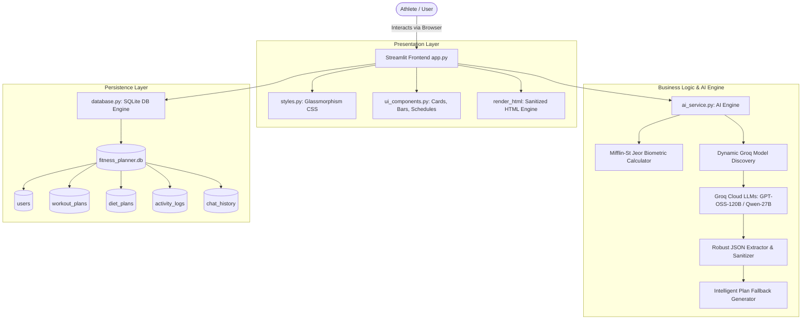

# ⚡ AeroFit AI — Intelligent Fitness & Nutrition Architecture

> A production-ready, full-stack AI-powered personal fitness and sports nutrition web platform built with **Streamlit**, **LangChain Groq**, and **SQLite**. AeroFit AI dynamically engineers periodized workout routines and macro-calibrated meal architectures tailored to each user's unique physiology, goals, equipment, and dietary restrictions.

---

## 📑 Table of Contents
1. [About the Project](#-about-the-project)
2. [Tech Stack](#-tech-stack)
3. [Key Features & Capabilities](#-key-features--capabilities)
4. [Architecture & Working of the Code](#-architecture--working-of-the-code)
   - [System Architecture Diagram](#system-architecture-diagram)
   - [End-to-End Data Flow](#end-to-end-data-flow)
   - [Core Code Modules Explained](#core-code-modules-explained)
   - [Biometrics & Nutrition Math Engine](#biometrics--nutrition-math-engine)
   - [Resilient AI Integration & Model Fallback](#resilient-ai-integration--model-fallback)
   - [Database Schema & Data Persistence](#database-schema--data-persistence)
5. [Project File Structure](#-project-file-structure)
6. [Getting Started & Installation](#-getting-started--installation)
7. [Environment Configuration](#-environment-configuration)
8. [Demo Profile & Usage](#-demo-profile--usage)
9. [License](#-license)

---

## 📌 About the Project

Traditional fitness apps often present generic, one-size-fits-all workout templates and static diet plans that fail to adapt to individual physiological constraints, joint injuries, culinary traditions, or home gym equipment.

**AeroFit AI** solves this problem by functioning as a 24/7 personal strength coach and sports clinical dietitian. By combining clinical biometric formulas (Mifflin-St Jeor equation) with cutting-edge Large Language Models hosted on **Groq Cloud** (`openai/gpt-oss-120b`, `qwen/qwen3.8-27b`, `llama-3.3-70b-versatile`), the application:
1. Calculates precise thermodynamic caloric demands (BMR and TDEE).
2. Formulates periodized, day-by-day training splits with exact exercise cues, sets, reps, and rest intervals.
3. Structures categorized meal plans (Breakfast, Lunch, Dinner, Snacks) with gram-level macronutrients and portion weights.
4. Tracks real-time exercise and meal completions with persistent database storage.
5. Provides an interactive, context-aware AI Coach ready to substitute exercises or troubleshoot nutrition on the fly.

---

## 🛠 Tech Stack

| Layer | Technology | Purpose |
| :--- | :--- | :--- |
| **Frontend Framework** | [Streamlit](https://streamlit.io/) | Reactive web application framework with custom component layouts |
| **UI/UX Styling** | HTML5 / CSS3 / Glassmorphism | Custom dark fitness aesthetic, CSS grid, glowing badges, responsive cards |
| **Language** | Python 3.10+ / 3.13 | Core programming language |
| **AI / LLM Orchestration** | [LangChain](https://www.langchain.com/) / `langchain-groq` | Chat model prompt templates, message pipelines, and structured generation |
| **Inference Hardware** | [Groq Cloud LPU™](https://groq.com/) | Ultra-low-latency inference for large models (`openai/gpt-oss-120b`, `qwen/qwen3.8-27b`) |
| **Database & Persistence** | [SQLite3](https://www.sqlite.org/) | Embedded relational database for users, plans, activity logs, and chat |
| **Security & Hashing** | Python `hashlib` (SHA-256 with Salt) | User password hashing and secure credential verification |
| **Environment Management** | `python-dotenv` | Secure loading of environment variables and API keys |

---

## 🌟 Key Features & Capabilities

### 1. 📊 Executive Fitness Command Center (Dashboard)
- **Biometric Calibration**: Displays current body weight, target weight delta, calculated BMI, and WHO health status classification.
- **Energy Targets**: Daily target calories vs. estimated Total Daily Energy Expenditure (TDEE).
- **Active Protocol Cards**: Instant snapshots of your active training routine and nutritional plan with direct one-click navigation.
- **Discipline Tracker**: Live counters for exercises completed today and cumulative lifetime discipline metrics.
- **Quick Shortcuts**: Fast access to past archives, the AI Coach, and profile settings.

### 2. 🏋️‍♂️ Dedicated Workout Planner
- **Customizable Program Builder**:
  - **Goals**: Weight Loss & Definition, Hypertrophy, Strength & Power, Conditioning, Lean Recomp.
  - **Experience Levels**: Beginner (0-1 yrs), Intermediate (1-3 yrs), Advanced (3+ yrs).
  - **Splits**: Push/Pull/Legs (PPL), Upper/Lower, Full Body, 5-Day Bro Split, HIIT Functional Circuits.
  - **Equipment Availability**: Full Commercial Gym, Home Dumbbells & Bench, Resistance Bands & Pull-up Bar, Calisthenics Only.
  - **Safety & Constraints**: Dedicated inputs for joint sensitivities, injuries, and target session durations.
- **Structured Day-Wise Schedules**: Organized into day tabs with dynamic warm-ups, technical workouts, and cooldown mobility stretches.
- **Exercise Breakdown Cards**: Name, target muscle group, sets, rep ranges, rest times, and coaching form cues.
- **Interactive Exercise Checklist**: One-click completion toggles per exercise that immediately log progress into the database.

### 3. 🥗 Dedicated Diet & Nutrition Planner
- **Macronutrient Breakdown Card**:
  - Caloric target banner with gram totals for **Protein**, **Carbohydrates**, and **Healthy Fats**.
  - Visual percentage contribution bars illustrating your energy distribution.
- **Categorized Meal Architecture**:
  - Day broken down into dedicated meal cards: **🌅 Breakfast**, **☀️ Lunch**, **🥪 Afternoon Snack**, and **🌙 Dinner**.
  - **Interactive Tabs**: View meals individually or switch to the **📋 View All Meals** full-day overview.
- **Precision Portions & Macro Badges**:
  - Every food item lists portion weights (e.g., *60g rolled oats, 1 scoop whey, 180g chicken breast*).
  - Individual food macro tags for Protein, Carbs, Fats, and Calories.
  - Culinary preparation notes and optimal meal timing advice.
- **Daily Meal Completion**: Check off meals as eaten throughout the day to track nutritional consistency.
- **Hydration Directives**: Daily water consumption targets (liters) and sports nutrition recovery rules.

### 4. 📜 Persistent User History & Archive
- **Historical Blueprint Storage**: Complete archive of all previously generated workout and diet plans saved with exact timestamps.
- **Zero-Friction Reactivation**: Switch back to any past plan with a single click (*"Set as Active Plan"*) without re-querying the AI or losing old data.
- **Discipline & Activity Logs**: Preserves records of completed exercises, sets, and meals per date.
- **Management**: Ability to inspect or delete obsolete plans.

### 5. 💬 Real-Time AI Fitness Coach ("Aero Coach")
- **Context-Aware Intelligence**: The AI coach is pre-briefed on your biometrics, your active workout split, and your daily caloric targets.
- **Quick Action Prompts**: One-click questions for exercise alternatives (e.g., if gym equipment is occupied), high-protein recipes, and DOMS recovery techniques.
- **Persistent Conversation**: Chat history is stored in SQLite and loads seamlessly across sessions.

### 6. ⚙️ Profile Calibration & Multi-User Support
- **Dynamic Biometric Recalculation**: Updating body weight, height, age, activity level, or goals instantly updates estimated TDEE and baseline macros.
- **Authentication**: Built-in user registration and credential validation, ensuring each athlete's plans and logs remain completely isolated.

---

## 🏗 Architecture & Working of the Code

### System Architecture Diagram



---

### End-to-End Data Flow

1. **User Profile & Input Formulation**:
   The user enters parameters (e.g., workout split, diet preferences, injuries) through Streamlit forms.
2. **Biometric Pre-Calculation**:
   `ai_service.py` evaluates the user's weight, height, age, gender, and activity multiplier using the Mifflin-St Jeor equation to calculate baseline BMR and TDEE.
3. **Prompt Synthesis & LLM Invocation**:
   A prompt instructing the model to output a strict JSON schema is constructed and dispatched to Groq Cloud using `ChatGroq`.
4. **Resilient JSON Parsing & Validation**:
   `extract_json_from_text()` extracts the JSON payload using regex, cleans trailing formatting anomalies, and validates required keys (`schedule` or `meals`). If an LLM response is malformed, `create_fallback_workout_plan()` or `create_fallback_diet_plan()` produces a balanced structured plan so the application never breaks.
5. **Database Persistence**:
   The plan is serialized as JSON and saved to `fitness_planner.db` via `database.py`. It is set as the active plan for that user ID.
6. **Safe HTML Rendering**:
   `ui_components.py` uses `render_html()` to sanitize all HTML templates (stripping indentation and blank lines), ensuring Streamlit never misinterprets HTML as code blocks.
7. **Interactive Tracking**:
   When a user clicks "Mark as Completed", `toggle_activity_status()` updates `activity_logs` in SQLite, triggering a lightweight UI rerun.

---

### Core Code Modules Explained

- **`app.py`**:
  The central controller and page router. Manages session state (`st.session_state`), sidebar navigation, multi-user authentication, and renders the Dashboard, Workout Planner, Diet Planner, History, Coach Chat, and Settings views.
- **`database.py`**:
  The SQLite data abstraction layer. Implements thread-safe connections, automatic table initialization (`init_db`), password hashing (SHA-256 + salt), user authentication, CRUD operations for workout and diet plans, and daily activity completion tracking.
- **`ai_service.py`**:
  Manages interactions with Groq LLMs. Implements automatic model capability discovery, Mifflin-St Jeor math calculation, workout prompt engineering, diet prompt engineering, JSON regex extraction, and conversational coach responses.
- **`ui_components.py`**:
  Contains presentation widgets including `render_macro_breakdown()`, `render_single_meal_card()`, `render_diet_interactive_plan()`, `render_workout_interactive_schedule()`, and the critical `render_html()` sanitizer.
- **`styles.py`**:
  Contains the CSS stylesheet (`CUSTOM_CSS`) implementing the dark glassmorphic design system, custom scrollbars, glowing badges, metric boxes, and responsive media queries.

---

### Biometrics & Nutrition Math Engine

AeroFit AI utilizes the validated **Mifflin-St Jeor Formula** to establish baseline energy expenditure:

$$\text{BMR}_{\text{Men}} = 10 \times \text{weight (kg)} + 6.25 \times \text{height (cm)} - 5 \times \text{age (yrs)} + 5$$

$$\text{BMR}_{\text{Women}} = 10 \times \text{weight (kg)} + 6.25 \times \text{height (cm)} - 5 \times \text{age (yrs)} - 161$$

$$\text{TDEE} = \text{BMR} \times \text{Activity Multiplier}$$

*Activity Multipliers:*
- **Sedentary**: $1.200$
- **Lightly Active**: $1.375$
- **Moderately Active**: $1.550$
- **Very Active**: $1.725$
- **Extremely Active**: $1.900$

*Caloric & Macronutrient Partitioning:*
- **Weight Loss / Cutting**: $\text{Target} = \text{TDEE} - 450\text{ kcal}$; Protein at $2.2\text{ g/kg}$; Fats at $25\%$ of calories; Carbs balance remaining energy.
- **Hypertrophy / Bulking**: $\text{Target} = \text{TDEE} + 350\text{ kcal}$; Protein at $2.0\text{ g/kg}$; Fats at $25\%$ of calories; Carbs fuel glycogen stores.
- **Maintenance / Recomp**: $\text{Target} = \text{TDEE}$; Protein at $1.8\text{ g/kg}$; Fats at $28\%$ of calories.

---

### Resilient AI Integration & Model Fallback

Groq model availability can fluctuate based on account tiers or API updates. To ensure zero downtime, `ai_service.py` queries the active Groq model registry via `client.models.list()` on startup and selects the best available LLM according to priority:

```python
PREFERRED_MODELS = [
    "openai/gpt-oss-120b",
    "qwen/qwen3.8-27b",
    "openai/gpt-oss-20b",
    "llama-3.3-70b-versatile"
]
```

If an API key lacks access to a specific model or encounters a 404, it automatically rolls over to the next capable model or falls back to the embedded sports physiology template without crashing the UI.

---

### Database Schema & Data Persistence

The application uses an embedded SQLite database (`fitness_planner.db`) with 5 relational tables:

```
┌─────────────────────────────────┐       ┌─────────────────────────────────┐
│              users              │       │          workout_plans          │
├─────────────────────────────────┤       ├─────────────────────────────────┤
│ id (PK)                         │◄──┐   │ id (PK)                         │
│ username (UNIQUE)               │   └───│ user_id (FK)                    │
│ password_hash                   │       │ title                           │
│ name, age, gender               │       │ goal, experience_level, split   │
│ height_cm, weight_kg            │       │ plan_json (TEXT)                │
│ target_weight_kg, fitness_goal  │       │ is_active (0 or 1)              │
│ created_at                      │       │ created_at                      │
└─────────────────────────────────┘       └─────────────────────────────────┘
                 ▲                                         ▲
                 │                                         │
┌────────────────┴────────────────┐       ┌────────────────┴────────────────┐
│           diet_plans            │       │          activity_logs          │
├─────────────────────────────────┤       ├─────────────────────────────────┤
│ id (PK)                         │       │ id (PK)                         │
│ user_id (FK)                    │       │ user_id (FK)                    │
│ title, diet_type                │       │ plan_type ('workout' | 'diet')  │
│ target_calories, target_protein │       │ plan_id                         │
│ plan_json (TEXT)                │       │ item_key (e.g. 'd1_e1')         │
│ is_active (0 or 1)              │       │ date_str ('YYYY-MM-DD')         │
│ created_at                      │       │ status ('completed')            │
└─────────────────────────────────┘       └─────────────────────────────────┘
```

---

## 📁 Project File Structure

```
AIFitnessPlanner-main/
│
├── app.py                  # Main entry point & Streamlit multi-page router
├── ai_service.py           # Groq LLM integration, prompt schemas, and nutrition math
├── database.py             # SQLite persistence layer, user auth, and activity logs
├── styles.py               # Custom dark fitness CSS stylesheet (glassmorphism)
├── ui_components.py        # Reusable presentation widgets, macro bars & safe HTML engine
├── fitness_planner.db      # Local SQLite database (created on first run)
├── requirements.txt        # Python package dependencies
├── .env                    # Environment variables (GROQ_API_KEY)
└── README.md               # Complete project documentation
```

---

## 🚀 Getting Started & Installation

### Prerequisites
- Python 3.10, 3.11, 3.12, or 3.13 installed on your system.
- A free or paid [Groq Cloud API Key](https://console.groq.com/keys).

### Step 1: Clone the Repository
```bash
git clone https://github.com/vikrambhat2/AIFitnessPlanner.git
cd AIFitnessPlanner
```

### Step 2: Set Up a Virtual Environment (Recommended)
```bash
# Windows
python -m venv venv
venv\Scripts\activate

# macOS / Linux
python3 -m venv venv
source venv/bin/activate
```

### Step 3: Install Required Dependencies
```bash
pip install -r requirements.txt
```

---

## 🔑 Environment Configuration

Create a file named `.env` in the root of the project directory and insert your Groq API key:

```env
GROQ_API_KEY=gsk_your_actual_groq_api_key_here
```

> **Note:** If you do not have a key, obtain one for free at [console.groq.com](https://console.groq.com/).

---

## 💻 Running the Application

Launch the Streamlit web application:

```bash
streamlit run app.py
```

Or using Python's module launcher:

```bash
python -m streamlit run app.py
```

Once launched, open your web browser and navigate to:
```
http://localhost:8501
```

---

## 👤 Demo Profile & Usage

The application auto-seeds a demonstration athlete on its initial launch so you can explore all features immediately:

- **Username**: `demo_athlete`
- **Password**: `fitness123`

You can also create a new profile at any time by opening the sidebar and expanding **"👤 Switch or Register Account"**.

---

## 🛡️ License

This project is licensed under the MIT License. Feel free to modify, extend, and adapt it for personal fitness tracking or commercial coaching applications.
